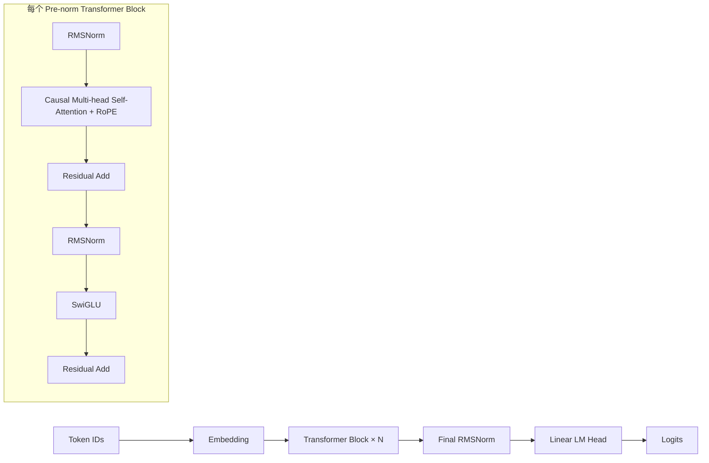

# CS336 Assignment 1：从零实现 Tokenizer 与 Transformer

这是 Stanford CS336 Assignment 1 的个人学习项目。项目从基础张量运算出发，实现 GPT 风格 Byte-level BPE Tokenizer、Transformer Language Model 及训练所需组件，并用 TinyStories 验证 tokenizer 与 token 数据流水线。

当前已经完成核心组件和完整 TinyStories BPE tokenizer 训练。TinyStories 训练集的 token 编码仍在进行；真实语料上的 Transformer 训练、生成、消融实验和作业报告尚未完成。本文档中的性能数字仅来自仓库内实际保存的 tokenizer stats，不包含尚未进行的 LM 或 GPU benchmark。

## 1. Project Overview

- 项目可在 Windows 与 WSL 环境中开发；下方命令以 Linux/WSL 为例。
- 课程 handout：[`cs336_assignment1_basics.pdf`](./cs336_assignment1_basics.pdf)。
- 核心实现位于 `cs336_basics/`，参考测试位于 `tests/`，数据处理脚本位于 `scripts/`。
- 原始语料、编码结果、checkpoint 和实验运行产物保留在本地，不纳入 Git。

项目重点是自己构建并检查每一层组件之间的接口：从字节和合并规则，到 attention、Transformer、next-token loss 和训练更新。

## 2. Implemented Components

| 模块 | 当前实现 |
| --- | --- |
| Tokenizer | GPT-2 风格正则预切分、Byte-level BPE 训练、encode/decode、special token、流式 encode iterator |
| BPE 训练优化 | 可选流式语料读取、增量更新受影响的 pair 统计 |
| 神经网络层 | Linear、Embedding、RMSNorm、SwiGLU、RoPE、causal scaled dot-product attention、多头 self-attention |
| Transformer | Pre-norm Transformer Block、Transformer LM 和词表 logits 输出 |
| 训练基础设施 | softmax、cross entropy、gradient clipping、AdamW、带 warmup 的 cosine LR scheduler、随机 next-token batch |
| Checkpoint | model/optimizer/iteration 的保存与恢复函数；训练入口目前只调用保存，不接入恢复 |
| TinyStories pipeline | 全量 BPE 训练脚本、uint16 训练语料流式编码脚本、validation 编码产物 |

代码状态以实际实现和测试为准。Tokenizer 的 vocab/merges 文件读写目前由 `scripts/train_tinystories_bpe.py` 提供，不是 `Tokenizer` 类的 `from_files` API。

## 3. Architecture



Attention 使用 causal mask；RoPE 用于 query/key 的位置编码。训练目标是把输入序列右移一位作为标签，最小化 token-level cross entropy。

## 4. BPE Tokenizer Implementation

实现以 UTF-8 字节作为基础词表，使用 GPT-2 风格 Unicode 正则将文本拆成 pre-token，再依 merge rank 顺序执行 BPE。训练代码先计算 pre-token 和 pair 频次，逐轮合并最高频 pair；Tokenizer 支持普通文本及配置的 special token 编解码。

完整 TinyStories tokenizer 产物在本地 `artifacts/tokenizer/full_tinystories_vocab10000/`：词表大小 10,000，merge rules 9,743。训练脚本对保存后重载的 vocab/merges 做相等性断言，并检查普通文本和 `<|endoftext|>` 的 encode/decode。实验细节见 [`docs/EXPERIMENTS.md`](docs/EXPERIMENTS.md)。

## 5. Streaming / Incremental BPE Optimization

`train_bpe(..., streaming=True)` 以 chunk 读取 TinyStories，并把完整故事段落送入 pre-tokenizer；chunk 尾部保留为 remainder，避免在故事边界处切断文本。每轮合并后只更新受该 pair 影响的 pre-token 的局部 pair 统计，而不是重新扫描全部 pre-token。

完整语料运行耗时与进程峰值 RSS 记录在 `artifacts/tokenizer/full_tinystories_vocab10000/tokenizer_stats.json`。这是一次本地实验数据，不是跨硬件的性能承诺。复现实验会重新训练完整 BPE，耗时较长；本次整理没有重跑它。

## 6. TinyStories Training Results

目前的 TinyStories 结果是 tokenizer 训练与数据准备结果，不是 Transformer LM 训练结果：

- 全量训练文本：2,227,753,162 bytes。
- vocab：10,000；merge rules：9,743。
- BPE training time：629.7227 s；峰值进程 RSS：99.55 MiB。
- validation token 文件 `artifacts/encoded/valid.bin`：4,762,512 bytes，即 2,381,256 个 little-endian uint16 token IDs；范围和 batch 对齐检查通过。
- 训练 token 文件当前仍是 `artifacts/encoded/train.bin.part`，编码进程在运行；最终 `.bin`、token 总数及完整验证尚未确认。

尚无真实 TinyStories Transformer training loss、validation loss、PPL、生成质量或 GPU latency 数据。根目录的本地 `checkpoint.pt` 不作为 TinyStories 训练结果，也不会上传。

## 7. Data Processing Pipeline

```text
TinyStories raw train/valid text
        ↓
已训练并保存 vocab + merges（vocab=10,000）
        ↓
valid.txt → valid.bin（已验证，uint16）
train.txt → train.bin.part（编码仍在运行）→ 校验通过后才改名为 train.bin
        ↓
真实 Transformer LM training（尚未接通）
```

数据下载源和文件路径见下方 Usage。`scripts/encode_tinystories.py` 先写入 `.bin.part`，再做大小、token ID 范围和 next-token batch 检查；全部通过后才替换为 `train.bin`。编码正在运行时不要再启动同一脚本，因为它会重新打开临时文件。

数据和实验产物由 `.gitignore` 排除。请不要把 TinyStories 原始语料、`train.bin` / `valid.bin`、`artifacts/` 或 checkpoint 上传到 GitHub。

## 8. Tests and Verification

在 2026-10-11 使用现有 WSL 环境 `.venv-wsl/bin/python` 运行：

```sh
.venv-wsl/bin/python -m pytest -p no:cacheprovider
```

结果：**47 passed, 1 xfailed, 0 failed, 0 skipped**（48.67 s）。`test_encode_memory_usage` 是测试自身标记的预期 xfail。测试过程中 PyTorch 报告本机 NVIDIA driver 版本低于当前 CUDA runtime 要求；测试通过，但这不代表 GPU 可用于训练或性能测量。

这次还检查了核心模块和两份数据脚本可导入。`valid.bin` 的 memmap、uint16 大小、token ID 范围和训练 batch 已核验。`train.bin.part` 仍在编码中，完整文件校验留待编码结束后进行。

## 9. Installation and Usage

环境要求：Python 3.12–3.13；依赖由 `pyproject.toml` 和 `uv.lock` 管理。Linux/WSL 示例：

```sh
uv sync
uv run pytest -p no:cacheprovider
```

从 Hugging Face 获取 TinyStories 原始文本（数据仅保存在本地）：

```sh
mkdir -p data
wget -O data/TinyStoriesV2-GPT4-train.txt https://huggingface.co/datasets/roneneldan/TinyStories/resolve/main/TinyStoriesV2-GPT4-train.txt
wget -O data/TinyStoriesV2-GPT4-valid.txt https://huggingface.co/datasets/roneneldan/TinyStories/resolve/main/TinyStoriesV2-GPT4-valid.txt
```

在数据和 tokenizer 准备好后，脚本入口为：

```sh
uv run python -m scripts.train_tinystories_bpe
uv run python -m scripts.encode_tinystories
```

第一条会重新训练全量 BPE；第二条会创建或替换训练集编码文件。当前训练集编码已经在运行，不要重复启动第二条。脚本采用固定项目路径，运行前应确认相应输入、输出状态。

`uv run python -m cs336_basics.train` 当前只运行一个小型合成周期序列 demo（CPU、200 iterations），不是 TinyStories 训练，并会写入根目录 `checkpoint.pt`。真实语料训练入口尚待接通。

## 10. Current Progress

核心模块已实现，完整参考测试通过；全量 BPE 训练完成；validation 编码完成；训练集编码仍在进行。整体完成度粗略估计约 **55%**：核心实现和 tokenizer/data preparation 占据了主要基础工作，但真实 LM 训练、生成、实验和 writeup 仍未完成。该数字是按作业工作项估算，不是测试分数。

详细证据和阶段记录见 [`docs/PROJECT_STATUS.md`](docs/PROJECT_STATUS.md)。

## 11. Remaining Work

1. 完成并验证 `train.bin`，确认 token 数量、uint16 范围、batch 读取和最终文件名。
2. 将 memmap 训练/validation 数据接入 LM 训练入口，补齐 checkpoint resume，并先做短程 smoke test。
3. 检查 GPU 可用性后做训练与 checkpoint resume 验证；实现 prompt generation、temperature、top-p、`max_new_tokens` 和 EOS stopping。
4. 完成 architecture、learning rate、batch size 实验及 OpenWebText（按课程要求和资源评估）。
5. 汇总可复现结果并完成 assignment writeup。

按依赖关系拆分的路线图见 [`docs/ROADMAP.md`](docs/ROADMAP.md)。

## 12. References

- [Stanford CS336: Language Modeling from Scratch](https://cs336.stanford.edu/)
- [CS336 Assignment 1 starter repository](https://github.com/stanford-cs336/assignment1-basics)
- 本地作业要求：[`cs336_assignment1_basics.pdf`](./cs336_assignment1_basics.pdf)
- [TinyStories dataset](https://huggingface.co/datasets/roneneldan/TinyStories)
- [PyTorch documentation](https://pytorch.org/docs/stable/index.html)
