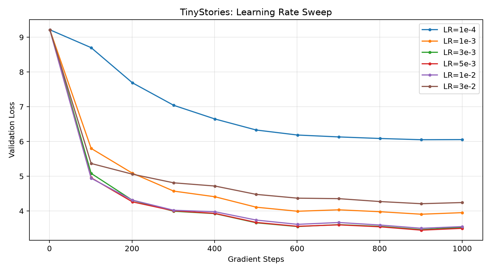
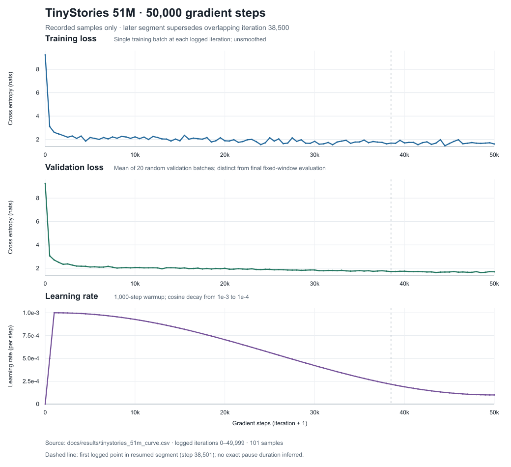

# 实验记录

审查日期：2026-10-12。以下结果来自真实 stats、CSV、Checkpoint 加载和短推理，不以旧 README 或任务背景替代证据。原始数据与模型产物保持在本地，仓库只保存轻量结果与图。

[来源与 SHA-256](results/source_manifest.json) · [核验记录](results/verification.md)

## BPE Scalability

[可核查 CSV](results/bpe_scalability.csv)逐项转录本地 `artifacts/tokenizer/**/tokenizer_stats.json`。输入大小使用 bytes；MB 为十进制，RSS 为 MiB。

| 实验目录（artifacts/tokenizer 下） | Corpus bytes | Vocab | Merges | Time (s) | Peak RSS (MiB) |
| --- | ---: | ---: | ---: | ---: | ---: |
| 根目录 tokenizer | 100,807 | 300 | 43 | 0.0613 | 22.24 |
| streaming_smoke | 100,807 | 300 | 43 | 0.0496 | 22.08 |
| scale_1mb | 1,007,405 | 300 | 43 | 0.3858 | 26.69 |
| scale_10mb | 10,074,023 | 1,000 | 743 | 3.4779 | 66.60 |
| scale_10mb_vocab3000 | 10,074,023 | 3,000 | 2,743 | 4.0396 | 66.99 |
| scale_10mb_vocab10000 | 10,074,023 | 10,000 | 9,743 | 4.8614 | 66.75 |
| scale_100mb_vocab10000 | 100,741,548 | 10,000 | 9,743 | 29.2527 | 54.55 |
| full_tinystories_vocab10000 | 2,227,753,162 | 10,000 | 9,743 | 629.7227 | 99.55 |

当前 `scripts/train_tinystories_bpe.py` 为 full corpus、vocab=10,000、streaming=True；TinyStories streaming 仅支持 `<|endoftext|>` 作为故事边界。普通文本按 GPT-2 风格 Unicode regex 预切分，以 UTF-8 bytes 构建词表。合并时维护 pair frequency 与 pair-to-pretoken 索引，仅更新受影响序列；选最大频率 pair 时仍扫描当前 pair 表。

完整产物实际有 10,000 vocab entries、9,743 merges，EOS ID=256，与 256 bytes + 1 special token + merges 一致。本次最终模型生成也成功加载该 tokenizer；没有重新训练 BPE。训练脚本含保存后重载、round-trip 和 special token assertions，但旧 stats 文件未保存这些 assertion 的独立执行日志。

这些是单次本地观测，没有多次运行的方差、对照硬件或完整历史源码快照。不同 vocab 的行不能当成只改变 corpus size 的控制变量实验；RSS 不单调增加，也不是内存复杂度证明。不能从 tokenizer 时间推断 GPU 模型训练性能。

## Encoded Dataset

- Train raw：`data/TinyStoriesV2-GPT4-train.txt`，2,227,753,162 bytes。
- Validation raw：`data/TinyStoriesV2-GPT4-valid.txt`，22,502,601 bytes。
- Train encoded：`artifacts/encoded/train.bin`，1,082,458,694 bytes / 2 = **541,229,347 tokens**。
- Validation encoded：`artifacts/encoded/valid.bin`，4,762,512 bytes / 2 = **2,381,256 tokens**。
- 两个最终文件都存在；本次不存在编码中的 `.part` 文件或正在运行的项目编码进程。
- 按 little-endian uint16 各抽样 163,840 IDs；train 抽样范围 10–9985，valid 为 10–9977。本次没有重新扫描全部 1.08 GB，也没有重跑编码。

当前编码脚本先按完整故事拼接 EOS，再写 `.bin.part`；文件大小、全文件 ID 范围和 next-token 窗口检查通过后改名为正式 `train.bin`。这种源码流程与正式文件存在相符，但原始编码日志未保留于可见产物。脚本只提供 train 默认入口，validation 编码没有独立 CLI 或完整运行配置归档。

## Learning Rate Sweep

原始日志：

- `artifacts/experiments/lr_sweep/lr_{1e-04,1e-03,3e-03}.csv`
- `artifacts/experiments/lr_sweep_high/lr_{5e-03,1e-02,3e-02}.csv`
- 各目录的 `summary.csv`

每个日志有 11 个采样点，iteration 0、100、…、900、999；终点与对应 summary 一致。使用的小模型配置由当前 sweep/比较脚本与 checkpoint 加载架构核对：vocab=10,000、context=128、d_model=64、layers=2、heads=4、d_ff=128，共 **1,362,240 参数**。当前 sweep 脚本 batch=4、1,000 iterations、warmup=20、min_lr=peak_lr×0.1、weight_decay=0.01，并在每组前将 Torch/NumPy seed 重置为 42。

| Peak LR | Final random-window validation loss | Segment elapsed (s) |
| --- | ---: | ---: |
| 1e-4 | 6.054452 | 17.3104 |
| 1e-3 | 3.951396 | 12.0467 |
| 3e-3 | 3.529395 | 12.6372 |
| 5e-3 | 3.499775 | 16.0770 |
| 1e-2 | 3.549906 | 12.4666 |
| 3e-2 | 4.242196 | 11.8645 |

[精确数值与各行来源](results/lr_sweep_summary.csv)



图为既有 `artifacts/experiments/lr_sweep_plots/loss_vs_steps.png` 的原样副本；本地 `scripts/plot_lr_sweep.py` 读取上述六个 CSV，以 iteration+1 为横轴。elapsed 包含该次运行的训练及评估开销，未采用专门的性能测量协议，不作为 GPU latency/吞吐 benchmark。

### 固定窗口比较

来源：`artifacts/experiments/fixed_validation_lr_comparison.csv` 与本地 `scripts/compare_lr_checkpoints.py`；仓库副本为 [fixed_validation_lr_comparison.csv](results/fixed_validation_lr_comparison.csv)。

- Seed=2026，100 batches × batch 8 × context 128 = 102,400 evaluation positions。
- 使用同一组预先生成的 validation 起点，两个 checkpoint 均为 iteration 999。
- 3e-3：Loss=3.492080636024475；PPL=32.85423434531199。
- 5e-3：Loss=3.4727014780044554；PPL=32.22367651997825。
- PPL=exp(mean cross-entropy)。固定窗口可能相互重叠，并非完整验证集。

结论限于这次小模型与 1,000-step 预算。5e-3 的较低 loss 没有多 seed 显著性估计，不能推广为 51M 的最优 LR。

**复现缺口**：当前 `lr_sweep.py` 只包含高 LR 三组，低 LR 三组的独立脚本版本未保存；现有日志和 checkpoint 保留了结果，但不足以宣称全部配置已经版本化。

## 51M Model & Training

实际参数数量通过现有脚本的完成检查确认：**51,147,264**。公式为：

```text
2 × vocab × d_model
+ layers × (4 × d_model² + 3 × d_model × d_ff + 2 × d_model)
+ d_model
= 51,147,264
```

两套词表投影对应独立 Embedding 与 LM Head；每个 Block 包含四个 attention 投影、三个 SwiGLU 投影、两个 RMSNorm，最后还有一个 RMSNorm。公式用于核对参数量，不是新的架构设计。

当前本地训练入口：`scripts/train_tinystories_51m.py`。

| 配置 | 值 |
| --- | --- |
| Vocab / context | 10,000 / 256 |
| d_model / layers / heads / d_ff | 512 / 12 / 8 / 1536 |
| RoPE theta | 10,000 |
| Batch / total iterations | 8 / 50,000 |
| Peak / min LR / warmup | 1e-3 / 1e-4 / 1,000 |
| AdamW betas / eps / decay | (0.9, 0.999) / 1e-8 / 0.01 |
| Gradient clip | Global L2 norm 1.0 |
| Validation / checkpoint interval | 500 / 2,000 iterations |
| 每次训练期 validation | 20 random batches |

最终 Checkpoint：`artifacts/checkpoints/tinystories_51m.pt`，613,878,304 bytes；本次同架构 model 和 optimizer state 成功加载，iteration=49,999，完成检查返回 resume position 50,000，未进行新的训练更新。Checkpoint SHA-256：

```text
43f9be14347cf5c2d094fd84206797f946ec01375a65ac1cec1646ffd3246f57
```

最终路径名义预测位置数为 50,000 × 8 × 256 = **102,400,000**。这是按 iteration 计数的处理位置，包含 LR=0 的 iteration 0，不是独立 token 数、数据集 epoch 数或中断重算后的实际总计算量。

训练入口要求 CUDA；本次加载/生成设备为 CUDA，硬件核验为 RTX 4060 Laptop GPU（8188 MiB）。现有 checkpoint 没有记录历史 GPU 型号或完整训练环境；没有找到峰值训练 allocated VRAM 的保存日志，用户背景中的约 2.129 GiB 不列为已核实指标。

## 51M Training Curve

原始 Segment 与有效记录：

| Segment | 原始记录 | 首 iteration | 尾 iteration | 合并后保留 |
| --- | ---: | ---: | ---: | ---: |
| segment_000.csv | 78 | 0 | 38,500 | 77 |
| segment_001.csv | 24 | 38,500 | 49,999 | 24 |

合并时按 Segment 编号顺序处理；每加入后一段，删除此前大于等于其第一个已记录 iteration 的点，再加入新段。此处仅丢弃 segment_000 的 iteration=38,500，保留恢复后的值 train_loss=1.6896059513、val_loss=1.7220323682。最后得到 101 个严格递增、无重复的 iteration，token 计数与 `(iteration+1)×2048` 一致；每点 LR 与当前 warmup/cosine 配置的计算值吻合。

日志能够证明恢复段覆盖了先前记录，但不能仅凭每 500 步一个日志精确确定恢复开始时间。周期 checkpoint 配置说明可能从较早 checkpoint 重算；本次没有留存中断时那个旧 checkpoint，所以不把推测的恢复起点当成已确认事实。

- Train loss：当步单 batch，未平滑、不是区间均值。
- Validation loss：每个日志点新抽 20 个 random batches，不是固定验证窗口。
- Iteration 为零起始；图横轴为 gradient steps=iteration+1。
- 连线连接采样点，未补造 50,000 个 loss 值。
- 虚线是恢复段第一个日志点（step 38,501），不代表精确恢复起点。
- `elapsed_run_seconds` 为各段局部计时。轻量 CSV 保留为 `elapsed_segment_seconds`，未构造全局 time；没有绘制 Loss–Time 图。

[合并 CSV](results/tinystories_51m_curve.csv) · [图的 SVG](figures/tinystories_51m_training.svg)



最后日志：train_loss=1.6134746074676514，random validation loss=1.6988329946994782，LR=0.00010000000092489007。不能把末条训练期 random validation loss 与固定评估混为同一测量。

## Final Fixed Validation

原始 `artifacts/experiments/tinystories_51m/fixed_validation_final.csv`，仓库副本 [fixed_validation_final.csv](results/fixed_validation_final.csv)：

- Checkpoint iteration：49,999。
- Loss：**1.6692702758312226**。
- Perplexity：**5.308292793964665**。
- Seed：2026。
- 100 batches × 8 × 256 = **204,800 evaluated positions**。
- 窗口起点由 `numpy.random.default_rng(2026)` 预先采样；可以重复或重叠。

配置由当前本地 `scripts/eval_tinystories_51m.py` 核对，exp(loss) 与保存的 PPL 精确相符。本次只读取已有 CSV，没有重新执行 100-batch 评估。原 CSV 的 `learning_rate` 列实际保存模型标签 `51M_final`，不是 LR 数值；保留原字段以便与源文件逐项比较。

## Generation & Limitations

本次实际执行已有本地 `scripts/generate_tinystories_51m.py`，读取 final checkpoint，在 CUDA 上生成最多 150 tokens，Seed=42、Temperature=0.8、Top-p=0.9、context=256。[完整未修饰输出](results/generation_51m.txt)

故事有 Lily、妈妈、做蛋糕和分享等基本情节，也有 `They put it on a rack and the cake.`、`they added the cake to the cake.` 等语法/逻辑和重复问题。单一 prompt 不足以评估模型的普遍生成质量，不能将其表述为通用对话能力或现实世界理解能力。

生成源码支持空 prompt/采样参数检查、EOS stopping 与 context 截断，但没有独立生成行为测试、KV Cache 或全面质量评测。Checkpoint 仅存 model/optimizer/iteration，不保存 RNG state 或 model/tokenizer configuration。

## Publication & Remaining Experiments

本次只发布文档、轻量 CSV/manifest 与图片。当前本地训练循环的新改动和实验脚本仍未提交，详见 [PROJECT_STATUS.md](PROJECT_STATUS.md)。因此本记录展示的是已审查的本地成果，不能宣称新克隆已包含整个复现代码。

尚无完成证据：正式 batch-size sweep、architecture ablation、OpenWebText、GPU profiling/稳定性能 benchmark，以及全部官方书面题/writeup。
